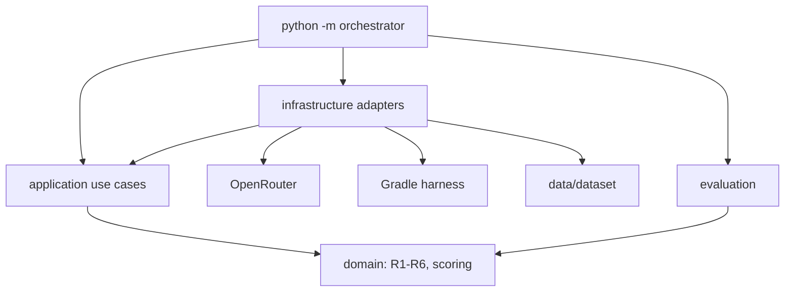

# Architecture-Constrained UI Migration

Command-line research artifact for the graduation thesis *Architecture-Constrained UI Migration: Improving LLM-based Translation from Android XML Layouts to Jetpack Compose with MVVM Compliance* (Dang Vu Quynh Huong, UEH). It re-executes the protocol of Paper 244 (Nguyen & Dang, ICAIN 2026): constraint-aware prompting plus a static-analysis-guided refinement loop (k = 4, rules R1–R6) on a stratified 150-screen Apache-2.0 benchmark.

This repository is a CLI pipeline only. It does not include a web app, demo server, or GUI.

## Architecture



See [docs/ARCHITECTURE.md](docs/ARCHITECTURE.md).

## Requirements

- Python ≥ 3.11
- JDK 17
- Android SDK with an API 34 emulator
- Gradle wrapper (in `apps/harness`)
- ktlint on PATH (optional but used when present)
- OpenRouter account

Target operator environment: Windows 11 + PowerShell; Linux and macOS are also supported (`pathlib` only).

## Setup

```powershell
python -m venv .venv
.\.venv\Scripts\Activate.ps1
pip install -e ".[dev]"
Copy-Item .env.example .env
```

Put your own OpenRouter key in `.env`. Never commit `.env`.

## Usage

All commands: `python -m orchestrator <command>`.

1. `preflight`
2. `freeze-benchmark`
3. `select-ground-truth` then `verify-ground-truth`
4. `make-workers N`
5. `run matrix|ablation|b0 --workers N`
6. `validate`
7. `collect`
8. `stats`
9. `labeling prepare` then `labeling score`
10. `code-similarity`
11. `visual-fidelity`
12. `figures`

Dataset helpers: `mine`, `dataset-sources`.

Runs are resumable per result file. `run` is strict: it does not skip the harness or substitute another model.

## Protocol summary

Scenarios B0 / S1–S4, k = 4, models `openai/gpt-4o`, `google/gemini-2.5-flash`, `anthropic/claude-sonnet-4`, temperature 0.2, `max_tokens` 8192. R1–R6 and the statistical tests are specified in [docs/PROTOCOL.md](docs/PROTOCOL.md).

## Data sources

Screens under `data/dataset` currently come from eight Apache-2.0 repositories (counts from `meta.json`): `android/architecture-components-samples` (34), `android/databinding-samples` (4), `android/platform-samples` (97), `android/testing-samples` (10), `android/uamp` (13), `android/user-interface-samples` (52), `google/iosched` (44), `nickbutcher/plaid` (15). Generate the provenance table with:

```powershell
python -m orchestrator dataset-sources
```

That command reads every `meta.json`, groups by repository, and confirms the license through the GitHub API. The table is written to [docs/DATASET_SOURCES.md](docs/DATASET_SOURCES.md). Only repositories actually present in `data/dataset` are listed.

## Third-party code

The screens are redistributed with attribution under Apache-2.0. See [THIRD_PARTY_NOTICES.md](THIRD_PARTY_NOTICES.md) (generated by the same command). Keep each upstream LICENSE text, or a link to it, per Apache-2.0 §4.

## Reproducibility

- Call log (JSONL): timestamp, cache key, cached flag, requested and returned model, run_index, temperature, max_tokens, reasoning, prompt version, seed, tokens, cost_usd, latency, finish_reason, screen, scenario, preset, iteration.
- Cache key = SHA-256(model, temperature, system prompt, prompt, run_index). Runs 2–3 are independent API calls.
- Strict mode on `run`: unknown model, missing harness, or `model_returned` mismatch raises.
- Gemini 2.0 Flash and Claude 3.x Sonnet are no longer served; substitutes are listed above.

This tree does not contain experimental result numbers. Tables are produced only after a real run.

## License and citation

No license file is present in this repository yet. Ask the author before redistributing beyond the thesis examination copy.

Cite Paper 244 as Nguyen & Dang, ICAIN 2026, and this artifact as the thesis re-execution by Dang Vu Quynh Huong.

## Author

Dang Vu Quynh Huong — huongdang1290@gmail.com
